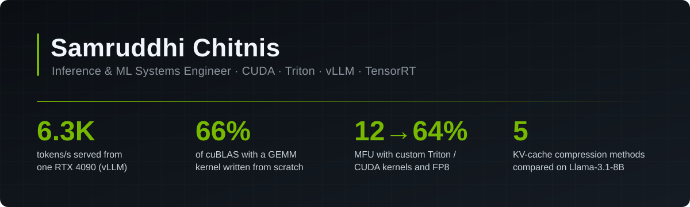

I work on the layer between the model and the GPU: serving engines, kernels, quantization and memory. Most of my projects start with a simple question, like "how much can one GPU actually serve?", and end with a profiler open and a number I can defend.

Master's student at San José State University, based in San Jose, CA. Looking for **Inference Engineer** and **ML Systems** roles.

### Selected work

| Project | What I built | What I found |
|---|---|---|
| [**squeeze-the-4090**](https://github.com/samruddhichitnis02/squeeze-the-4090) | LLM serving study on one RTX 4090: Hugging Face vs vLLM vs TensorRT-LLM, FP8 and INT4, load tests and knob sweeps | vLLM served **106x** the HF baseline. Under heavy load the bottleneck was the Python API layer, not the GPU |
| [**cuda-gemm-optimization-lab**](https://github.com/samruddhichitnis02/cuda-gemm-optimization-lab) | Matrix-multiply kernels in CUDA C++, rewritten four times with Nsight Compute, plus a fused Triton kernel | **5.2x** faster than my first kernel and **66% of cuBLAS**; the Triton fusion beat PyTorch by **1.56x** |
| [**FuseRT**](https://github.com/samruddhichitnis02/FuseRT) | ONNX graph optimizer for BERT with custom fusion passes, benchmarked on ONNX Runtime and TensorRT | Cut the graph from **1,231 to 599 nodes**. TensorRT already did most of it, so I profiled what it left slow, aiming at custom fused kernels |
| [**llm-training-performance**](https://github.com/samruddhichitnis02/llm-training-performance) | Fused Triton and CUDA kernels, FP8 and NVFP4 for a Llama-style model on Blackwell, plus a roofline model | **12% → 64% MFU** (5.24x). The roofline model predicts step time within 4.6% |
| [**298a-kv-cache-compression**](https://github.com/samruddhichitnis02/298a-kv-cache-compression) | Master's capstone: five 2026 KV-cache compression methods on Llama-3.1-8B at the same memory budget | In progress: which methods still hold up on long documents (LongBench, RULER) |

### Toolbox

**Inference & GPU:** CUDA C++, Triton, vLLM, TensorRT / TensorRT-LLM, ONNX Runtime, FP8 / INT4 / NVFP4, Nsight Systems & Compute

**ML:** PyTorch, torch.compile, Hugging Face Transformers, PEFT / LoRA, JAX

**LLM apps:** LangGraph, LangChain, RAG, FAISS, ChromaDB, FastAPI

**Languages:** Python, C++, SQL, TypeScript

### Contact

[samruddhichitnis02@gmail.com](mailto:samruddhichitnis02@gmail.com) · [LinkedIn](https://www.linkedin.com/in/samruddhi-chitnis/)
